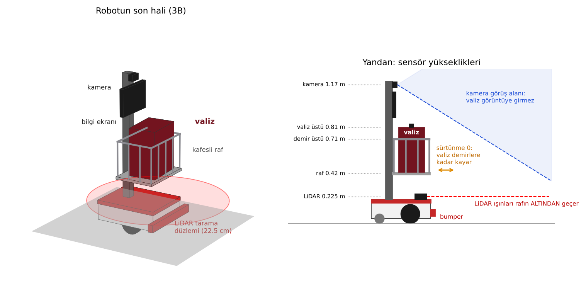
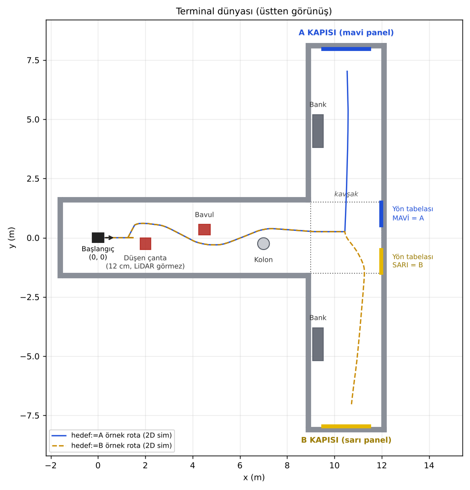
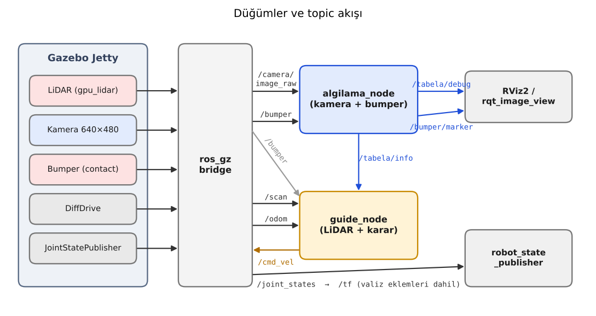
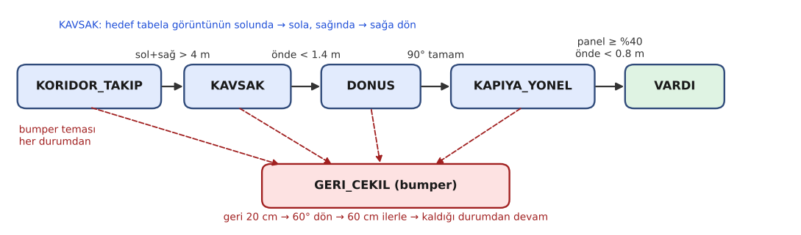
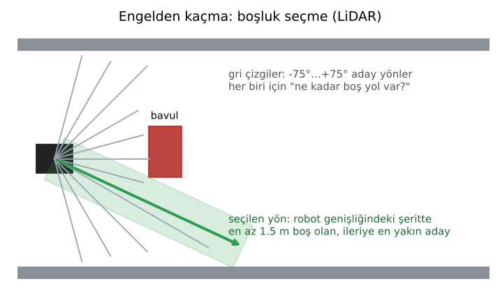

# Havalimanı Rehber Robotu (`airport_guide`)

**BIMU4101 Mobil Robotiğe Giriş · Ara Sınav Projesi**

   

Havalimanı terminalinde yolcuyu gideceği kapıya götüren, üstünde yolcunun valizini de taşıyan bir rehber robot.
Robot koridorda engellerden kaçarak ilerler, kavşaktaki renkli yön tabelasını kamerasıyla okuyup doğru koridora
döner ve kapıya varınca durur. LiDAR'ın göremeyeceği kadar alçak bir engele çarparsa ön tampondaki temas sensörü
(bumper) devreye girer ve robot geri çekilip etrafından dolaşır.



> **Not:** Simülasyonda gerçek yazı okuma (OCR) yerine renk kodu kullanılır:
> **MAVİ tabela = A kapıları**, **SARI tabela = B kapıları**.

---

## İçindekiler

1. [Hızlı başlangıç](#hızlı-başlangıç)
2. [Robot](#robot)
3. [Terminal dünyası](#terminal-dünyası)
4. [Kurulum](#kurulum)
5. [Çalıştırma](#çalıştırma)
6. [Nasıl çalışıyor?](#nasıl-çalışıyor)
7. [Topic'ler](#topicler)
8. [Parametreler](#parametreler)
9. [Proje yapısı](#proje-yapısı)
10. [Sorun giderme](#sorun-giderme)
11. [Ekip ve katkılar](#ekip-ve-katkılar)
12. [Bilinen sınırlamalar](#bilinen-sınırlamalar)

---

## Hızlı başlangıç

Kurulum yapılmışsa tek komut yeter:

```bash
cd ~/airport_ws && source install/setup.bash
ros2 launch airport_guide_behavior baslat.launch.py hedef:=A   # mavi tabelayı izle, A kapısına git
ros2 launch airport_guide_behavior baslat.launch.py hedef:=B   # sarı tabelayı izle, B kapısına git
```

Gazebo ve RViz açılır, yaklaşık 8 saniye sonra robot yola çıkar ve ~80 saniyede kapıya varır.

---

## Robot

Diferansiyel sürüşlü bir gövde (önde 2 tahrikli teker, arkada sarhoş teker), üstünde bilgi ekranı taşıyan 1 m'lik
bir direk ve direğin önünde kafesli bir bagaj rafı.

| Parça | Ölçü / özellik |
|---|---|
| Gövde | 0.50 × 0.40 × 0.16 m, 8 kg |
| Tekerler | r = 0.08 m, tekerler arası 0.46 m (DiffDrive) |
| Direk + ekran | 1.0 m direk, 0.32 × 0.22 m ekran |
| Bagaj rafı | 0.32 × 0.44 m, yerden 0.42 m, etrafında 14 dikey demir + üst korkuluk (0.71 m) |
| Valiz | 0.22 × 0.32 × 0.38 m, 1.5 kg, raf üzerinde **sürtünmesiz** kayar |

### Sensörler

| Sensör | Gazebo tipi | Konum | Topic | Ne için? |
|---|---|---|---|---|
| **LiDAR** | `gpu_lidar`, 360 ışın, 0.12–10 m | gövde önü, yerden 0.225 m | `/scan` | Engel ve duvar mesafesi, kavşak tespiti |
| **Kamera** | `camera`, 640×480, 15 Hz, 80° FOV | direk ucu, yerden 1.17 m | `/camera/image_raw` | Renkli yön tabelası ve kapı paneli |
| **Bumper** | `contact` | ön tampon, 0.54 m genişlik | `/bumper` | LiDAR'ın altında kalan alçak engeller (yerdeki çanta) |

Sensörler birbirini engellemez: LiDAR ışınları rafın **altından** geçer, valiz ve demirler kameranın görüş
alanının **altında** kalır (yan görünüşteki ölçüler).

### Bagaj modülü (kafes + kayan valiz)

Valiz rafa üç serbest eklemle bağlıdır: ileri-geri (`valiz_x_joint`), sağa-sola (`valiz_y_joint`) ve kendi
etrafında dönme (`valiz_yaw_joint`). Eklemlerde sürtünme ve sönüm sıfırdır. Bu yüzden robot hızlanırken valiz
geriye, dururken öne kayar, dönüşlerde biraz savrulur. Eklem limitleri demirlerin iç yüzüne göre hesaplandığı
için valiz demire dayandığı yerde durur.

| Eklem | Tip | Limit |
|---|---|---|
| `valiz_x_joint` | prismatic | ±1.6 cm |
| `valiz_y_joint` | prismatic | ±3.0 cm |
| `valiz_yaw_joint` | revolute | ±0.08 rad (~4.6°) |


---

## Terminal dünyası

T şeklinde bir terminal: düz koridor, sonunda bir kavşak, kavşaktan sola A kapıları, sağa B kapıları.



| Nesne | Konum (x, y) | Amaç |
|---|---|---|
| Başlangıç | (0, 0), +x yönüne bakar | |
| Düşen çanta | (2.0, -0.25), 12 cm yükseklik | LiDAR düzleminin altında → **bumper testi** |
| Bavul | (4.5, 0.35) | LiDAR ile kaçınma |
| Kolon | (7.0, -0.25) | LiDAR ile kaçınma |
| Yön tabelaları | kavşak karşı duvarı, mavi (y = +1) ve sarı (y = −1) | Kamera ile dönüş yönü seçimi |
| Banklar | (9.3, ±4.5) | Kapı koridorlarında engel |
| Kapı panelleri | A: (10.5, +7.97) mavi, B: (10.5, −7.97) sarı | Varış tespiti |

---

## Kurulum

**Gereksinimler:** Ubuntu 26.04, ROS 2 Lyrical, Gazebo Jetty.

```bash
# 1) Bağımlılıklar
sudo apt update
sudo apt install ros-lyrical-ros-gz ros-lyrical-xacro ros-lyrical-robot-state-publisher \
  ros-lyrical-cv-bridge ros-lyrical-rviz2 ros-lyrical-teleop-twist-keyboard \
  ros-lyrical-rqt-image-view python3-opencv python3-numpy

# 2) Çalışma alanı ve kaynak kod
mkdir -p ~/airport_ws/src && cd ~/airport_ws/src
git clone https://github.com/icoz-melihcan/airport-guide-robot.git

# 3) Derleme
cd ~/airport_ws
source /opt/ros/lyrical/setup.bash
colcon build --symlink-install
source install/setup.bash
```

Her yeni terminalde `source ~/airport_ws/install/setup.bash` çalıştırmayı unutmayın (ya da `~/.bashrc`'ye ekleyin).

---

## Çalıştırma

### Tek komutla (önerilen)

```bash
ros2 launch airport_guide_behavior baslat.launch.py hedef:=A
```

| Argüman | Varsayılan | Açıklama |
|---|---|---|
| `hedef` | `A` | `A` = mavi tabela / A kapısı, `B` = sarı tabela / B kapısı |
| `gecikme` | `8.0` | Gazebo açıldıktan kaç saniye sonra robot yola çıksın (yavaş bilgisayarda artırın) |

### İki terminalle (geliştirme / hata ayıklama için)

```bash
# Terminal 1: Gazebo dünyası + robot + köprü + RViz
ros2 launch airport_guide_gazebo sim.launch.py

# Terminal 2: rehber davranışı
ros2 launch airport_guide_behavior rehber.launch.py hedef:=A
```

Robotu elle sürmek isterseniz Terminal 2 yerine:

```bash
ros2 run teleop_twist_keyboard teleop_twist_keyboard
```

### Ne görmelisiniz?

Terminalde durum geçişleri sırayla yazılır:

```text
[guide_node]: guide_node basladi. Hedef: A kapisi
[guide_node]: DURUM: KORIDOR_TAKIP -> GERI_CEKIL        # yerdeki çantaya çarptı (bumper)
[guide_node]: DURUM: GERI_CEKIL -> KORIDOR_TAKIP
[guide_node]: Kavsak: A tabelasi SOLDA (hata=-0.42) ...
[guide_node]: DURUM: KAVSAK -> DONUS
[guide_node]: DURUM: DONUS -> KAPIYA_YONEL
[guide_node]: *** A KAPISINA ULASILDI! ***
```

**RViz'de:** robot modeli (valizin kayması dahil), LiDAR noktaları, kamera görüntüsü ve bumper'a dokunulunca
kırmızıya dönen küre.

**Tabela tespitini canlı izlemek için:**

```bash
ros2 run rqt_image_view rqt_image_view /tabela/debug
```

---

## Nasıl çalışıyor?

### Düğümler



- **`algilama_node`** (kamera + bumper): Kamera görüntüsünü HSV renk uzayına çevirir, hedef renge ait pikselleri
  maskeler ve en büyük lekeyi bulur. Lekenin görüntü merkezine göre yatay sapmasını (`hata`, −1…+1) ve görüntüde
  kapladığı alanı (`alan`, 0…1) `/tabela/info` olarak yayınlar. Bumper mesajlarını RViz için bir markere çevirir.
- **`guide_node`** (LiDAR + karar): LiDAR, odometri, bumper ve tabela bilgisini birleştirip bir durum makinesiyle
  `/cmd_vel` üretir.

| Renk | HSV alt sınır | HSV üst sınır |
|---|---|---|
| Mavi (A) | (105, 120, 60) | (135, 255, 255) |
| Sarı (B) | (22, 120, 60) | (38, 255, 255) |

### Durum makinesi



1. **KORIDOR_TAKIP:** Engellerden kaçarak koridor boyunca ilerler, koridorun ortasında kalmaya çalışır.
2. **KAVSAK:** Sol ve sağ duvar mesafelerinin toplamı 4 m'yi aşınca kavşağa girilmiştir. Kamera hedef tabelayı
   görüntünün solunda görüyorsa sola, sağında görüyorsa sağa dönülecektir. Karşı duvara 1.4 m kalana kadar düz gider.
3. **DONUS:** Odometriden okunan yönelimle tam 90° döner.
4. **KAPIYA_YONEL:** Kapı panelini görüntünün ortasında tutarak ilerler, yoldaki engelleri yine LiDAR ile dolaşır.
5. **VARDI:** Panel görüntünün %40'ından fazlasını kaplıyor ve önde 0.8 m'den az mesafe varsa durur.
6. **GERI_CEKIL:** Bumper herhangi bir durumda tetiklenirse: ~20 cm geri, ~60° dönüş, ~60 cm ileri, sonra
   kaldığı durumdan devam.

### Engelden kaçma: boşluk seçme



Robot −75° ile +75° arasında 5° aralıklarla aday yönler dener. Her aday için, **robot genişliğinde bir şerit**
boyunca LiDAR noktalarına bakarak "bu yönde ne kadar boş yol var?" sorusunu hesaplar. En az 1.5 m boş olan
adaylar arasından gitmek istediği yöne (koridor ekseni ya da tabela) en yakın olanı seçer. Duvara ya da kapıya
yaklaşırken bu 1.5 m eşiği kendiliğinden küçülür. Seçilen yönde 1.2 m'den az boş yol varsa yavaşlar, hiçbir yönde
0.5 m boş yol kalmadıysa yerinde döner.

---

## Topic'ler

| Topic | Mesaj tipi | Yayınlayan → Dinleyen |
|---|---|---|
| `/scan` | `sensor_msgs/msg/LaserScan` | Gazebo LiDAR → `guide_node`, RViz |
| `/camera/image_raw` | `sensor_msgs/msg/Image` | Gazebo kamera → `algilama_node`, RViz |
| `/bumper` | `ros_gz_interfaces/msg/Contacts` | Gazebo temas sensörü → `guide_node`, `algilama_node` |
| `/tabela/info` | `geometry_msgs/msg/Point` (x = hata, y = alan, z = görünüyor mu) | `algilama_node` → `guide_node` |
| `/tabela/debug` | `sensor_msgs/msg/Image` | `algilama_node` → RViz / rqt_image_view |
| `/bumper/marker` | `visualization_msgs/msg/Marker` | `algilama_node` → RViz |
| `/cmd_vel` | `geometry_msgs/msg/Twist` | `guide_node` → Gazebo DiffDrive |
| `/odom` | `nav_msgs/msg/Odometry` | Gazebo DiffDrive → `guide_node` |
| `/joint_states` | `sensor_msgs/msg/JointState` | Gazebo → `robot_state_publisher` (tekerler + valiz eklemleri) |
| `/tf`, `/clock` | | Gazebo → ROS 2 |

Köprü ayarları: `airport_guide_gazebo/config/bridge.yaml`.

---

## Parametreler

`guide_node` parametreleri çalışırken değiştirilebilir, örneğin:

```bash
ros2 param set /guide_node hiz 0.30
```

| Parametre | Varsayılan | Açıklama |
|---|---|---|
| `hedef` | `A` | Hedef kapı (launch argümanından gelir) |
| `hiz` | 0.35 m/s | Normal ileri hız |
| `yavas_hiz` | 0.15 m/s | Engel yakınındaki hız |
| `donus_hizi` | 0.6 rad/s | Yerinde dönüş hızı |
| `yari_genislik` | 0.32 m | Boşluk aranan şeridin yarı genişliği (robot + pay) |
| `bosluk_hedef` | 1.5 m | Seçilen yönde istenen boş yol |
| `engel_esik` | 0.5 m | Hiçbir yönde bu kadar boş yol yoksa yerinde dön |
| `yavas_esik` | 1.2 m | Seçilen yönde bundan az boş yol varsa yavaşla |
| `kavsak_genislik` | 4.0 m | Sol + sağ mesafe bunu aşınca kavşak |
| `kavsak_on_esik` | 1.4 m | Kavşakta dönmeden önce karşı duvara kalan mesafe |
| `varis_esik` | 0.8 m | Varış için öndeki en fazla mesafe |
| `varis_alan` | 0.4 | Varış için panelin görüntüde kapladığı en az oran |
| `yaklasma_alan` | 0.15 | Panel bu orandan büyükse doğrudan panele yönel |
| `min_kol_mesafe` | 3.0 m | Kavşaktan en az bu kadar uzaklaşmadan varış sayılmaz |
| `k_merkez` | 0.15 | Koridor ortalama kazancı |
| `k_don` | 1.2 | Yön düzeltme kazancı |
| `kamera_yari_fov` | 0.698 rad | Kameranın yatay görüş açısının yarısı |

---

## Proje yapısı

```text
airport-guide-robot/
├── airport_guide_description/        # Robot modeli (ament_cmake)
│   └── urdf/
│       ├── airport_guide.urdf.xacro  # gövde, tekerler, direk, ekran, DiffDrive
│       ├── bagaj.xacro               # kafesli raf + sürtünmesiz valiz
│       └── sensors/
│           ├── lidar.xacro
│           ├── camera.xacro
│           └── bumper.xacro
├── airport_guide_gazebo/             # Dünya ve simülasyon (ament_cmake)
│   ├── worlds/terminal.sdf
│   ├── launch/sim.launch.py
│   ├── config/bridge.yaml
│   └── rviz/airport_guide.rviz
├── airport_guide_behavior/           # Davranış düğümleri (ament_python)
│   ├── airport_guide_behavior/
│   │   ├── algilama_node.py
│   │   └── guide_node.py
│   └── launch/
│       ├── baslat.launch.py          # TEK KOMUT: simülasyon + davranış
│       └── rehber.launch.py          # sadece davranış düğümleri
├── docs/images/                      # README görselleri
└── README.md
```

---

## Sorun giderme

| Belirti | Sebep / çözüm |
|---|---|
| `/scan does not appear to be published` | `bridge.yaml`'da anahtar adı yanlış. Her blokta `gz_topic_name` olmalı (`topic_name` değil). `gz topic -l` ile Gazebo tarafındaki adı kontrol edin. |
| RViz: `Frame [odom] does not exist` | `/tf` ve `/odom` köprülenmiyor ya da Gazebo duraklatılmış. Simülasyonun oynatıldığından ve `bridge.yaml`'ın güncel olduğundan emin olun. |
| `AttributeError: 'RcutilsLogger' object has no attribute 'warn'` | ROS 2 Lyrical'da `warn` yok. Kodda `get_logger().warning(...)` kullanılmalı. |
| `/tabela/debug` görüntüsü donuk, robot kavşakta bekliyor | `algilama_node` çökmüş olabilir. İlk terminaldeki hata mesajına bakın (genelde yukarıdaki `warn` hatası). |
| Robot hiç hareket etmiyor | Gazebo'da simülasyon duraklatılmış olabilir (sol alttaki ▶). `ros2 topic echo /cmd_vel` ile komut gelip gelmediğine bakın. |
| Yeni terminalde `Package not found` | `source ~/airport_ws/install/setup.bash` yapılmamış. |
| `.bashrc` açılışta "No such file" hatası veriyor | `.bashrc`'de var olmayan bir çalışma alanı source ediliyor. O satırı `~/airport_ws/install/setup.bash` ile değiştirin. |
| Valiz sürekli titriyor / sallanıyor | `bagaj.xacro`'daki eklemlerde `damping` değerini 0.0'dan 0.2'ye çıkarın. |

---

## Ekip ve katkılar

| Öğrenci | Sensör sorumluluğu | Diğer işler |
|---|---|---|
| A: Melih Can İçöz | **LiDAR**: entegrasyon, `/scan`, RViz LaserScan | Proje iskeleti, robot modeli (Xacro + DiffDrive), `guide_node`, `rehber.launch.py` |
| B: Mehmet Bal | **Kamera**: entegrasyon, tabela tespiti, `/tabela/debug` | Terminal dünyası, `sim.launch.py`, köprü ayarları, RViz, `algilama_node`, README |
| Ortak | **Bumper**: B entegrasyon + RViz marker, A davranış tepkisi (geri çekilme) | Bagaj modülü (kafesli raf + kayan valiz) |

Her öğrencinin katkısı commit geçmişinde görülebilir.

---

## Bilinen sınırlamalar

- Tabela okuma gerçek OCR değil, renk tespitidir. Benzer renkte başka bir nesne tabela sanılabilir.
- Harita kullanılmaz (SLAM/Nav2 yok). Robot yalnızca bu T şeklindeki terminal düzenine göre ayarlanmıştır.
